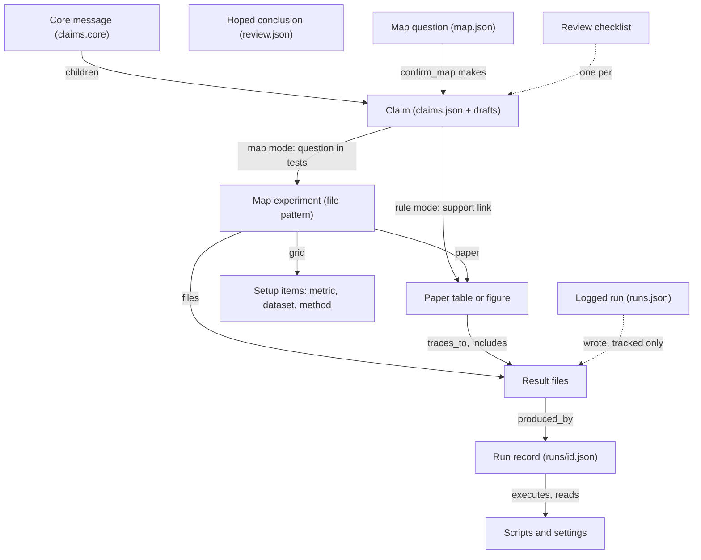
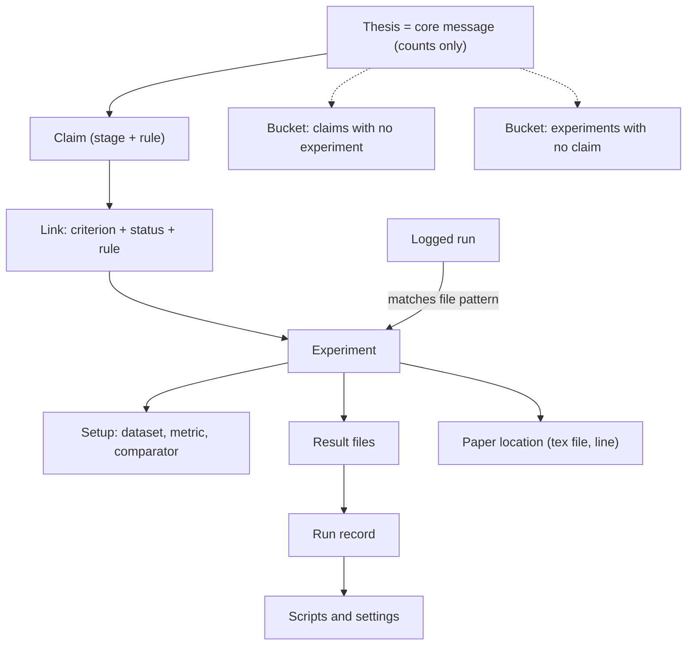

# 01 Object map: what backs what

Read from the top down. An arrow means "is backed by" or "is made of". Glossary: [README](README.md).

## Today (this branch)
- The core message is already the parent of every claim.
- An experiment reaches a claim in one of two ways. With a confirmed map, through the map question's `tests`. Without one, through the claim's support links to a paper table, figure or result file.
- Logged runs touch the spine only through the result files they wrote.

The status sits on the **experiment** (ahead / behind / tie / none against the best other method or the base). The claim's stage is computed from those.

## Proposed (ADR-008)
- A **link** with a criterion and a status sits between claim and experiment.
- The thesis shows counts.
- Logged runs join experiments by file pattern (build step 6).

| Object | Today | Proposed |
|---|---|---|
| Thesis | `claims.core`, with a stage rolled up by `_roll` | The same object; the header shows counts, no verdict word |
| Claim ↔ Experiment | `tests` (map) or support links (rules); no own status | `link {status, rule, why, criterion, criterion_by}` |
| Logged run ↔ Experiment | None | Joined by the experiment's file patterns; `running` state |
