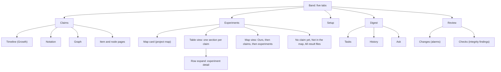
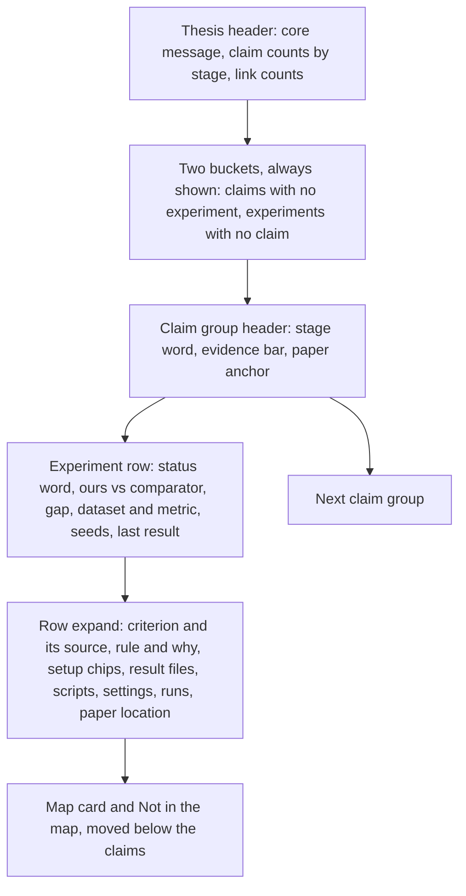
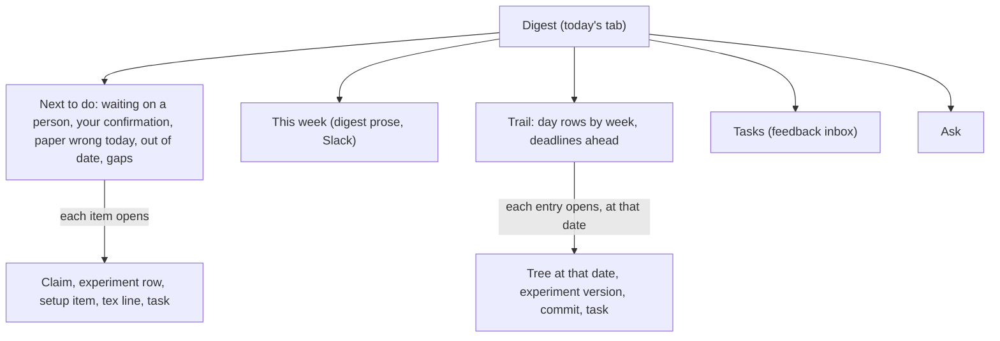
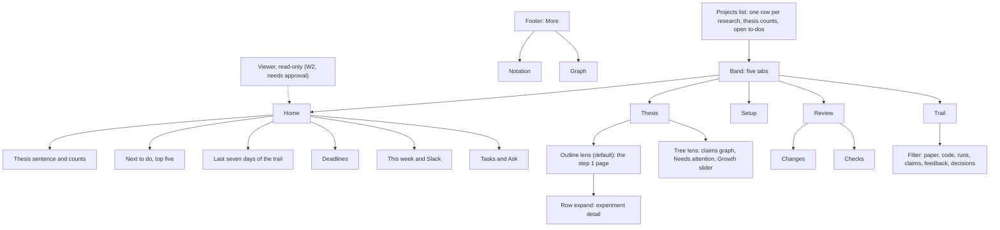

# 02 Page hierarchy

## Today (this branch)
There are five tabs in the band (`NAV` in `web/app.js`). Every other page belongs to one tab (`NAV_OF`), which then shows as active. Those pages are reached from links on that tab or from the footer.

Today's Experiments page, from top to bottom (Table view, the default): map card → "extends" line (if any) → counts line → one section per claim (stage chip, then experiment rows) → "No claim yet" → "Not in the map" → "All result files".

## Proposed, step 1: the top-down Experiments page (no nav change)

## Proposed, steps 4 and 5: To-do and Trail on today's tabs (no nav change)
Digest's "Open tasks" becomes **Next to do**, and its "History" section, the History page and the Timeline "Steps" list become the **Trail**.

## Proposed, phase 2 (needs Juhyeong's approval, decisions D6, D12, D14)
- Claims and Experiments become one tab, **Thesis**, with two lenses.
- Digest becomes **Home** for the research.
- History becomes **Trail**.
- There are five tabs, as today. The shell stays a top band (option S1).
- Old tab keys and VS Code links (`claims`, `experiments`, `digest`, `history`) open the matching place.

| Today | Phase 2 |
|---|---|
| Claims (tab) | Thesis → Tree lens |
| Experiments (tab) | Thesis → Outline lens |
| Digest (tab) | Home |
| History (under Digest) | Trail (tab) |
| Timeline | Growth slider in Thesis → Tree; its Steps list in Trail |
| Tasks, Ask | Under Home |
| Setup, Review (tabs) | Unchanged |
| Notation, Graph | Footer "More" |
