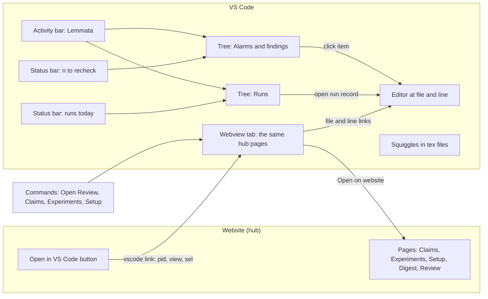
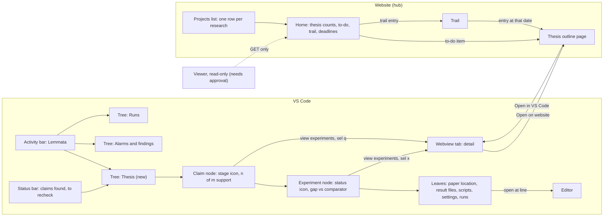

# 03 Website and VS Code navigation

## Today (this branch)
- VS Code has one Lemmata container with two native tree views, two status bar items, squiggles (diagnostics), and one webview tab.
- The webview tab shows the hub's own pages.
- The website opens VS Code through a `vscode://` link.

The link format is `vscode://lemmata-local.lemmata/open?pid=<project>&view=<page>&sel=<q:… | x:… | i:… | c:…>`. `view` is one of `VIEWS`: review, claims, experiments, setup, digest, timeline, tasks, notation, changes, graph, ask.

## Proposed (ADR-008, build step 7; website tabs as in phase 2, step 8)
- A native **Thesis** tree goes first in the container.
- Tree leaves open files at the line.
- A claim or an experiment opens its detail in the existing webview tab.
- No new status bar item; the first one carries the counts.

| Piece | Today | Proposed |
|---|---|---|
| Views in container | 2 (Alarms and findings, Runs) | 3 (Thesis, Alarms and findings, Runs) |
| Status bar | "Lemmata: n to recheck" + runs item | "Lemmata: 2/4 claims found · n to recheck" + runs item |
| `VIEWS` keys | review, claims, experiments, setup, digest, timeline, tasks, notation, changes, graph, ask | the same, plus `trail` and `home` (old keys stay as aliases) |
| Data for the tree | — | `GET /api/experiments` (nodes), `GET /api/experiment?id=` on expand (leaves); no new route |
