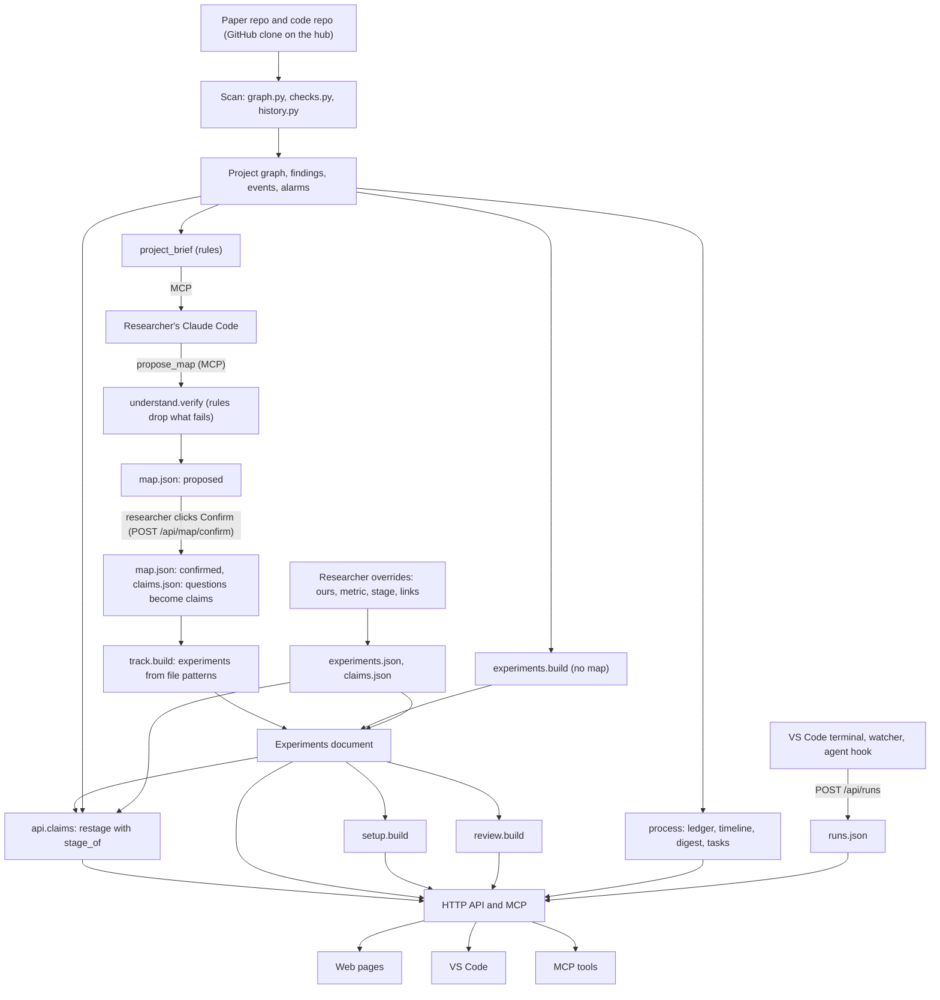
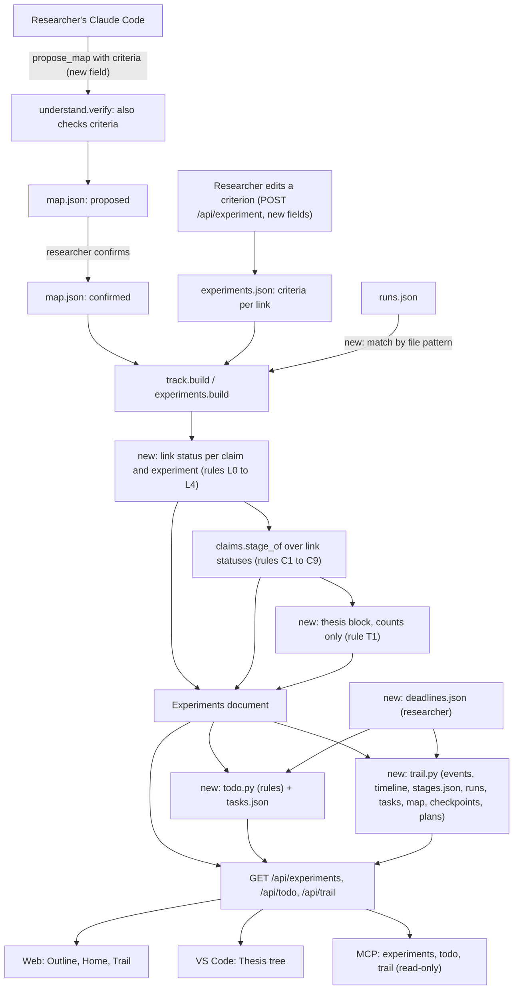

# 04 Data flow: from the repositories to each page

## Today (this branch)
- The hub runs **no model**.
- The researcher's own Claude Code reads the brief and proposes a map over MCP. Rules check the map, and only the researcher confirms it, in the web UI (ADR-007).
- Every page is computed by rules from the scan plus the stored decisions.

## Proposed (ADR-008)
The new parts are drawn with the word "new":
- criteria in the map and their overrides (step 3);
- link rules and the thesis block (steps 1-2);
- To-do and Trail built from documents that already exist (steps 4-5);
- deadlines (step 5);
- the join of logged runs to experiments (step 6).

| Stage | Who | Model? | Proposed change |
|---|---|---|---|
| Brief | Hub, rules | no | The brief text also explains how to draft a criterion |
| Map proposal | Researcher's own agent | yes, on their plan | May include `criteria` |
| Verify | Hub, rules | no | Checks each criterion: the metric is a column, the comparator is a method in the files, the question exists |
| Confirm | Researcher | no | Unchanged; the agent still has no confirm tool |
| Track and status | Hub, rules | no | Link status, stage rules, thesis block |
| To-do, Trail | Hub, rules | no | New, built from the documents above |
