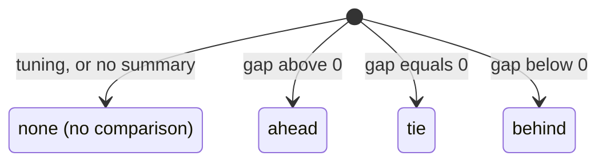
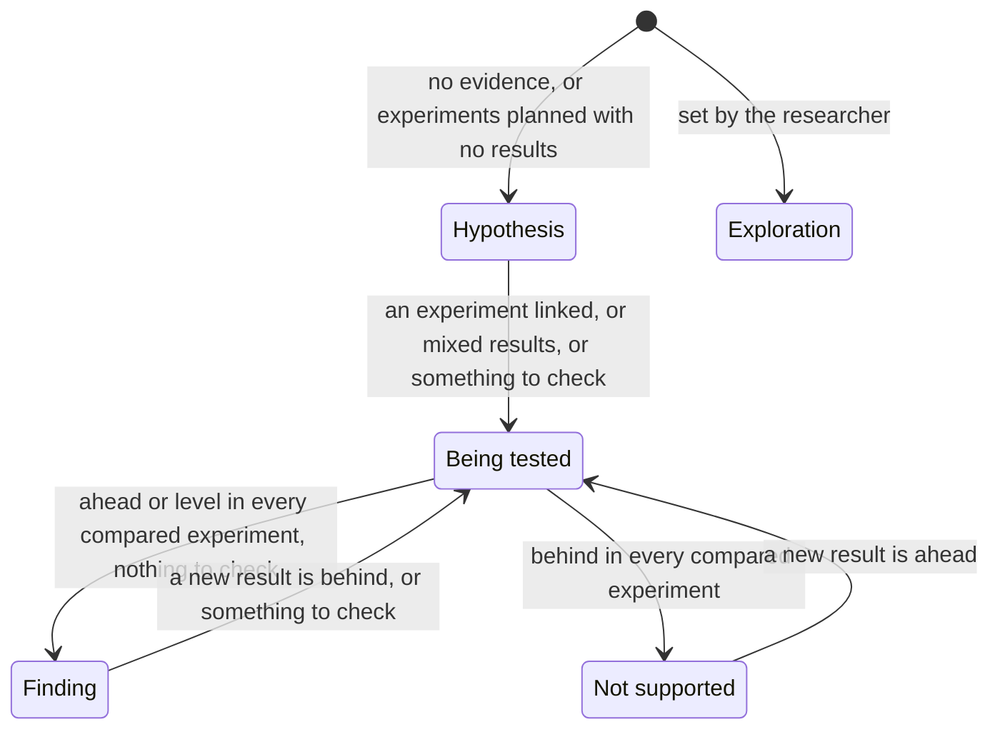
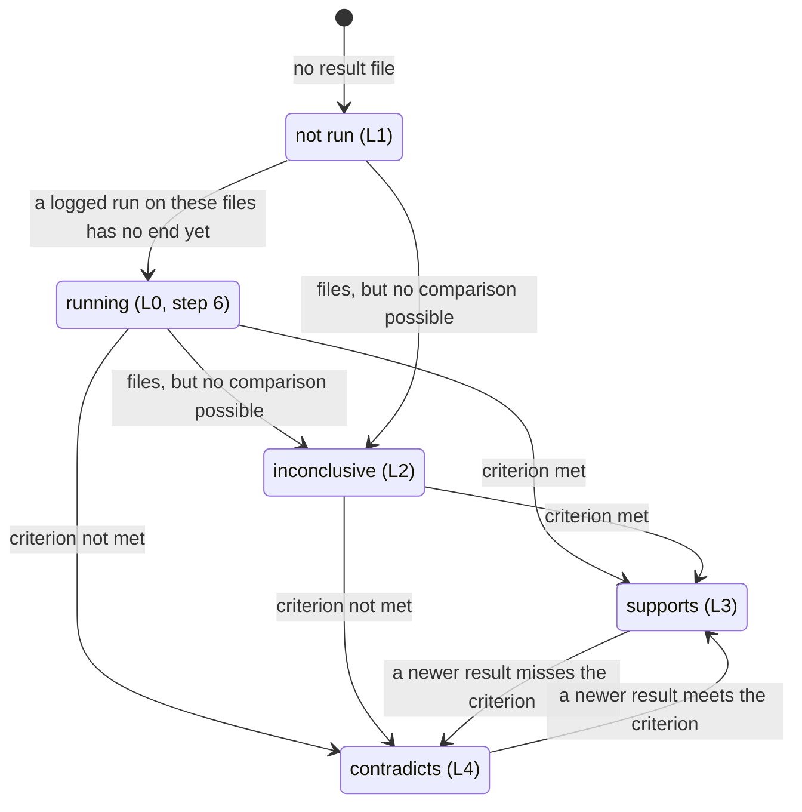
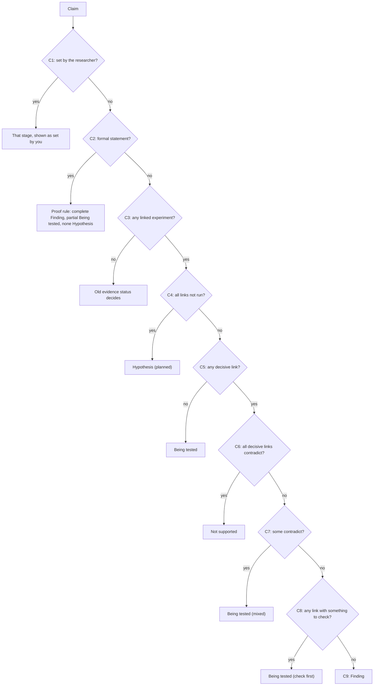

# 05 Status words and the rules that set them

All of these are rules. No model sets a status, and each status can show the rule and one sentence of why.

## Today (this branch)
**Experiment state** (`review._state`, used through `api._outcome`). Against the base when the work extends a paper and the claim is the extension's own; otherwise against the best other method.

**Claim stage** (`claims.stage_of`). The researcher can overrule it (`stage_by: you`). Exploration is set only by the researcher.

The core message's stage today is `_roll`: the shared stage if all claims agree, else Being tested. Recheck is a separate flag, set when a result is older than its code or settings.

## Proposed (ADR-008)
**Link status**, one per claim and experiment, against that link's criterion. With the default criterion it gives today's result: supports = ahead or tie, contradicts = behind.

Flags that never replace the word: `[recheck]` (stale), `!` (to check), guess, one run, criterion source (`default`, `drafted`, `confirmed`).

**Claim stage**, with the same words as today and numbered rules.

**Thesis (T1): counts only**, with no single word. For example: "4 claims: 2 Finding, 1 Being tested, 1 Hypothesis · 9 links: 6 supports, 1 contradicts, 1 inconclusive, 1 not run · 1 claim with no experiment · 2 experiments with no claim".

| Level | Today | Proposed |
|---|---|---|
| Experiment or link | ahead / tie / behind / none per experiment | supports / contradicts / inconclusive / not run (+ running) per link |
| Claim | the five stages, from `stage_of` | the same five, with rule ids C1-C9 |
| Thesis | `_roll` stage + stage meter | counts only (T1) |
